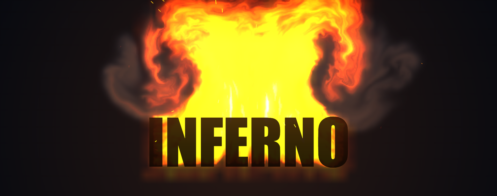

# fire-effect-text

[](https://www.aihonestybadge.com)

Burning text effect for React and plain JavaScript.



## Install

```bash
npm install fire-effect-text
```

## React

```jsx
import { useRef } from "react";
import { FireText } from "fire-effect-text/react";

export function Hero() {
  const fire = useRef(null);

  return (
    <>
      <FireText
        ref={fire}
        text="INFERNO"
        fontSize={104}
        fuel={1.2}
        flameHeight={1.2}
        overlayText
        overlayBlendMode="hard-light"
      />
      <button onClick={() => fire.current?.togglePause()}>Pause / Resume</button>
    </>
  );
}
```

## Vanilla JavaScript

```javascript
import { FireText } from "fire-effect-text/vanilla";

const fire = new FireText("#fire-stage", {
  text: "BLAZE",
  fontSize: 96,
  overlayText: true,
  overlayColor: "molten",
});

fire.setOptions({ text: "NEW TITLE", flameHeight: 1.5 });
fire.togglePause();
// fire.destroy();
```

## Script tag

```html
<div id="fire-container"></div>
<script src="https://unpkg.com/fire-effect-text/dist/fire-text.global.js"></script>
<script>
  const fire = new FireTextBundle.FireText("#fire-container", {
    text: "PYRO",
    fontSize: 84,
  });
</script>
```

## Renderers

The default `renderer: "auto"` tries WebGPU, then WebGL2, then Canvas2D. Canvas2D is the reference implementation and the fallback.

```javascript
const fire = new FireText("#stage", { renderer: "auto", fallback: true });

await fire.ready;
console.log(fire.renderer); // "webgpu" | "webgl2" | "canvas2d"

await fire.setRenderer("canvas2d"); // manual fallback
```

- `renderer`: `"auto"`, `"webgpu"`, `"webgl2"`, or `"canvas2d"`.
- `fallback`: defaults to `true`. When `false`, a failed requested backend rejects `ready`.
- `ready`: resolves after the first backend initializes.
- `renderer`: the active backend after initialization, or `null`.
- `onRendererChange({ requested, renderer, reason })`: fired after initialization and renderer switches.
- `onError(error)`: receives renderer initialization and context-loss errors.

WebGPU requires a secure context. WebGL2 requires float render targets. GPU output approximates the Canvas2D reference; use `renderer: "canvas2d"` for the exact reference look.

## Options

| Option | Type | Default | Description |
| --- | --- | --- | --- |
| `text` | `string` | `"FIRE"` | Text to render. Use `\n` for multiple lines. |
| `fontFamily` | `string` | system UI stack | Any CSS `font-family`. |
| `fontSize` | `number` | `96` | Font size in CSS pixels. |
| `fontWeight` | `string \| number` | `"900"` | CSS `font-weight`. |
| `fontStyle` | `string` | `"normal"` | CSS `font-style`. |
| `letterSpacing` | `string` | `"0px"` | CSS `letter-spacing`. |
| `fuel` | `number` | `1.15` | Flame fuel (`0.2` - `2.5`). |
| `flameHeight` | `number` | `1.0` | Flame reach and buoyancy (`0.15` - `3.0`). |
| `wind` | `number` | `0` | Horizontal wind (`-1.0` - `1.0`). |
| `autoWind` | `boolean` | `true` | Procedural wind modulation. |
| `simScale` | `number` | `3.0` | Simulation cell size (`1.8` - `6.0`). Lower is sharper. |
| `paused` | `boolean` | `false` | Freeze the simulation. |
| `interactive` | `boolean` | `true` | Click or drag over the canvas to blow the flames. |
| `pointerStrength` | `number` | `1.0` | Pointer impulse multiplier (`0` disables it). |
| `background` | `string` | `"#07090f"` | CSS background color or `"transparent"`. |
| `smoke` | `boolean` | `true` | Render the smoke plume. |
| `sparks` | `boolean` | `true` | Render ember sparks. |
| `bloom` | `boolean` | `true` | Render thermal glow. |
| `showTextBody` | `boolean` | `true` | Render the charred ember text body. |
| `overlayText` | `boolean` | `false` | Render crisp text above the fire. |
| `overlayBlendMode` | `string` | `"source-over"` | Canvas blend mode for the overlay. |
| `overlayColor` | `string` | `"ember"` | `"ember"`, `"molten"`, or any CSS color. |
| `overlayOpacity` | `number` | `0.82` | Overlay opacity (`0.0` - `1.0`). |
| `overlayStrokeColor` | `string` | warm amber | Overlay outline color. |
| `overlayStrokeWidth` | `number` | `1.5` | Overlay outline width in CSS pixels. |
| `flameHeadroom` | `number` | `1.35` | Extra space above the text. |
| `paddingX` | `number` | `0.55` | Horizontal padding. |
| `paddingBottom` | `number` | `0.35` | Bottom padding. |
| `width` | `number \| null` | `null` | Explicit canvas width. |
| `height` | `number \| null` | `null` | Explicit canvas height. |
| `renderer` | `string` | `"auto"` | Backend preference. |
| `fallback` | `boolean` | `true` | Allow automatic fallback. |

## How it works

- Glyph rasterization produces a heat and fuel field shaped like the text.
- A fluid-style advection and pressure solve moves the heat and soot upward.
- Temperature maps through a blackbody color ramp and tone mapping.

## Browser support

Canvas2D works in all modern browsers. WebGL2 needs float render targets. WebGPU needs a secure context and a browser with WebGPU enabled. The demo reports which backend is active.

## Development

```bash
npm install
npm start          # demo dev server
npm run build      # library bundles
npm test           # unit tests (src)
npm run test:dist  # built bundle smoke test
npm run typecheck
npm run test:browser
npm run build:demo
npm run screenshot
npm run pack:check
```

## Publishing

```bash
npm publish --access public
```

`prepack` builds the bundles and runs the dist smoke test. `prepublishOnly` runs the source tests.

## License

[MIT](LICENSE) © 2026 Jeff Davis
